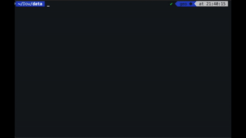
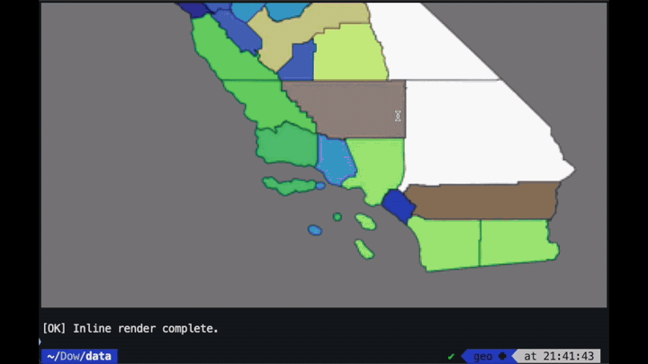

# viewinline
[](https://pepy.tech/project/viewinline)
[](https://pypi.org/project/viewinline/)
[](https://pypi.org/project/viewinline/)

**Quick-look geospatial viewer for compatible terminals.**  
Displays rasters, vectors, and tabular data directly in the terminal with no GUI.

<p align="center">
  <a href="viewinline_gif1.gif"></a>
  <a href="viewinline_gif2.gif"></a>
</p>

Think of it as `ls` for geospatial files — designed for quick visual inspection at the command line, not a replacement for QGIS, ArcGIS, or analytical workflows.

Particularly useful on HPC systems and remote servers accessed via SSH. Images render on your local terminal without X11 forwarding, VNC, or file downloads.

This tool combines the core display logic of `viewtif` and `viewgeom`, but is **non-interactive**: you can't zoom, pan, or switch colormaps on the fly. Instead, you control everything through command-line options (e.g. --display, --color-by, --colormap).

It uses the iTerm2 inline image protocol (OSC 1337) in supported terminals, and falls back to `chafa` in others, which displays real high-res images in terminals like kitty and Ghostty, and colored block-art (ASCII art) previews in Terminal.app, VS Code, and most Linux terminals. Without `chafa` installed, non-iTerm2-family terminals show an info message instead.

## Installation  
Requires Python 3.9 or later.  

```bash
pip install viewinline
```

## Usage
```bash
# Rasters
viewinline path/to/file.tif
viewinline R.tif G.tif B.tif                 # RGB composite (also works with --rgbfiles)
viewinline path/to/multiband.tif --rgb 3 2 1
viewinline path/to/folder --gallery 4x3      # show image gallery of all files in the folder (e.g. 4x3 grid)
viewinline path/to/hyperspectral.tif --bands 10-50 # show image gallery of selected bands (also works with --bands 11,15,30,45; --gallery 5x5)

# NetCDF and HDF
viewinline file.nc                           # list variables
viewinline file.nc --subset 2                # display variable 2
viewinline file.nc --subset 1 --band 10      # variable 1, timestep 10 --band or --timestep
viewinline temp.nc --subset 1 --colormap plasma --vmin 273 --vmax 310
viewinline hyperspectral.nc --subset 1 --reduce NumberOfScanlines  # override auto-detected axis
viewinline hyperspectral.nc --subset 22 --band 50 # show image gallery of selected bands
viewinline hyperspectral.nc --subset 22 --bands 10-54 --gallery 5x11

# Vectors
viewinline path/to/vector.geojson
viewinline boundaries.geoparquet --color-by population --colormap viridis

# Save to file
viewinline path/to/file.tif --export out.png   # save the rendered image as PNG (or .jpg)
viewinline scene.tif --rgb 4 3 2 --export rgb.png
viewinline dem.tif --colormap terrain --display 1 --export dem.png   # full-res with colormap

# Axis and grid overlay
viewinline path/to/file.tif --grid           # ticks + grid in the raster's CRS units (5 divisions)
viewinline path/to/file.tif --grid 10        # 10 divisions instead of the default 5
viewinline boundaries.geoparquet --grid      # ticks + grid in the vector's CRS units
viewinline photo.png --grid                  # pixel positions (no CRS)

# CSV and Parquet
viewinline data.csv                          # preview rows and columns
viewinline data.parquet --describe           # summary statistics
viewinline data.csv --hist                   # histograms for all numeric columns
viewinline data.csv --hist area_km2          # histogram for one column
viewinline data.csv --scatter X Y            # scatter plot
viewinline data.csv --where "year > 2010"    # filter rows
viewinline data.csv --sort population --desc # sort rows
viewinline data.csv --sql "SELECT * FROM data WHERE area > 100 ORDER BY year"  # full SQL

# Tabular view of vectors
viewinline counties.shp --table              # view shapefile as table
viewinline counties.shp --table --describe   # summary statistics
viewinline counties.shp --table --unique STATE_NAME
viewinline data.geoparquet --table --where "POP > 100000" --sort POP --desc
```

## Compatible terminals

Native (no extra install required): images render via the iTerm2 inline image protocol on:

- **iTerm2** (macOS)
- **WezTerm** (cross-platform)
- **Konsole** (Linux/KDE)
- **Rio**, **Contour** (cross-platform)

Via `chafa` (recommended for everyone else): install chafa and viewinline works in nearly every terminal:
- kitty, Ghostty, foot — real high-resolution images via the kitty graphics protocol or sixel
- Terminal.app, VS Code, GNOME Terminal, Alacritty, Warp, Hyper — colored block-art previews with 24-bit color

Install chafa once (it's a system binary, available across all conda/virtualenv environments):

```
brew install chafa          # macOS
sudo apt install chafa      # Debian/Ubuntu
sudo dnf install chafa      # Fedora
scoop install chafa         # Windows
```
Without chafa, terminals outside the native list above show an info message instead of an image.
You can also force the chafa path on any terminal by setting `INLINE_VIEWER_ENGINE=chafa`.

**SSH/HPC usage:** Works over SSH when connecting from a compatible terminal. Images render on your local machine, not the remote server. No X11 forwarding or VNC required.

**tmux/screen:** Inline images work inside tmux only when the outer terminal is iTerm2 (or WezTerm/Konsole/Rio/Contour). In tmux with other outer terminals (kitty, Terminal.app, etc.), viewinline displays ASCII art previews instead of full-quality images.

**Fallback:** In terminals that do not support inline images, you can fallback to ASCII art by installing [`chafa`](https://hpjansson.org/chafa/) command-line tool. Install `chafa` with your package manager (e.g. `brew install chafa` or `sudo apt install chafa`). You can also force the use of `chafa` by setting the environment variable `INLINE_VIEWER_ENGINE=chafa`.

## Features  
- Previews rasters, vectors, and tabular data directly in the terminal  
- Non-interactive: everything is controlled through command-line options
- **NetCDF/HDF Support:** Display variables from NetCDF (.nc) and HDF5 (.h5, .hdf5) files with automatic nodata detection and multi-slice navigation
- **Parquet/GeoParquet:** Render GeoParquet as vector maps or view as tabular data
- **Tabular View for Vectors:** Use `--table` to access CSV-style operations (filter, sort, describe, hist) on any vector file  
- **AI-agent inspection:** `--info` returns file metadata and statistics as JSON; `--export` saves a quick-look image for an agent to inspect. Designed for AI coding-agent workflows.

## Supported formats  
**Rasters**  
- GeoTIFF (.tif, .tiff)
- PNG, JPEG (.png, .jpg, .jpeg)
- NetCDF (.nc)
- HDF5 (.h5, .hdf5)
- HDF4 (.hdf) — requires GDAL with HDF4 support
- Single-band or multi-band composites 

**Composite inputs**  
- You can pass three rasters (e.g. `R.tif G.tif B.tif`) or use `--rgbfiles R.tif G.tif B.tif` to create an RGB composite
- Multi-band files: use `--rgb 3 2 1` to specify band order

**Vectors**  
- GeoJSON (`.geojson`)  
- Shapefile (`.shp`)  
- GeoPackage (`.gpkg`)
- Parquet/GeoParquet (`.parquet`, `.geoparquet`)

**Tabular data (CSV and Parquet)**
- CSV (`.csv`)
- Parquet (`.parquet`) — requires `pyarrow`
- All CSV operations work on parquet files
- Preview file summary (rows, columns, and names)
- Summary statistics with `--describe`
- Inline histograms with `--hist`
- Scatter plots with `--scatter X Y`
- Filter rows with `--where`, sort with `--sort`, limit output with `--limit`
- Full SQL queries with `--sql` (DuckDB required) — use `data` as the table name

**Tabular view of vectors**
- Use `--table` flag to view any vector file (shapefiles, GeoPackage, GeoParquet) as tabular data
- Enables all CSV-style operations: `--describe`, `--hist`, `--scatter`, `--unique`, `--where`, `--sort`

**Gallery view**
- Display all images in a folder with `--gallery 4x4`
- Display selected bands of a single raster as a grid with `--bands 101-120` or `--bands 11,12,45,55`. Works with GeoTIFF and NetCDF files.

**NetCDF/HDF notes:**
- viewinline lists only variables that can be displayed as 2D or 3D arrays
- 3D variables with time or known spatial dimensions are auto-handled (slices along the non-spatial axis)
- For 3D variables with non-standard dimensions (e.g., hyperspectral cubes like PICARD), viewinline auto-detects the band axis by smallest dimension. Use `--reduce DIM_NAME` to override.
- Variables with 4+ dimensions are not supported
- For a complete variable list, use `ncdump -h file.nc` or `viewtif`


## Dependencies

**Core dependencies** (installed automatically):
- `rasterio` — raster reading (includes GDAL)
- `geopandas`, `pyogrio` — vector reading
- `matplotlib` — vector rendering
- `Pillow` — image encoding
- `numpy`, `pandas` — data handling

**Optional dependencies:**
- `chafa` — strongly recommended for terminal coverage beyond iTerm2/WezTerm/Konsole/Rio/Contour. System binary, not a Python package. See "Terminal support" above for install instructions.
- `duckdb` — required for `--where`, `--sort`, `--sql`, `--limit` with filtering
  ```bash
  pip install duckdb
  ```
- `pyarrow` — required for Parquet/GeoParquet files
  ```bash
  pip install pyarrow
  ```
- `h5py` — fallback for HDF5 files if GDAL lacks HDF5 support (usually not needed)
  ```bash
  pip install h5py
  ```

**Note on HDF support:**
- **HDF5** (.h5, .hdf5): Supported via rasterio if GDAL has HDF5 support (most installations)
- **HDF4** (.hdf): Requires GDAL compiled with HDF4 support (the legacy format used by MODIS and older NASA products)
- **NetCDF** (.nc): Supported via rasterio (uses GDAL's NetCDF driver)

## Available options
```
General:
  --display DISPLAY     Resize only the displayed image (0.5=smaller, 2=bigger). Default: auto-fit to terminal.
  --info                Print file metadata and statistics as JSON, then exit (agent-facing). For NetCDF/HDF, lists variables; combine with --subset N to inspect one. Always returns JSON, including on error.
  --export PATH         Save the rendered image to PATH (.png/.jpg) and open it. Works with any display flag. Prints {"path": "..."} as the final line.
  --grid [N]            Overlay axis ticks and a light grid (N divisions, default 5). Labels are in the file's CRS units (degrees or metres) for georeferenced rasters and vectors; pixel positions for PNG/JPG, NetCDF, and non-georeferenced files.

Raster:
  --band BAND           Band number to display (single raster), or slice number for NetCDF. (default: 1)
  --bands BANDS         Display multiple bands as a grid. Accepts ranges (30-40), lists (3,4,5), or mixed (1,5,10-15).
  --rgb R G B           Three band numbers for RGB display (e.g., --rgb 4 3 2). Overrides default 1 2 3.
  --rgbfiles R G B      Three single-band rasters for RGB composite. Can also provide as positional arguments.
  --timestep INTEGER    Alias for --band when working with NetCDF files.
  --subset INTEGER      Variable index for NetCDF/HDF files (e.g., --subset 1).
  --reduce DIM_NAME     For 3D NetCDF variables, specify which dimension to use as the band/slider axis.  Auto-detected if omitted.
  --colormap            Apply colormap to single-band rasters. Flag without the color scheme → 'terrain'.
  --vmin VMIN           Minimum pixel value for raster display scaling.
  --vmax VMAX           Maximum pixel value for raster display scaling.
  --nodata NODATA       Override nodata value for rasters if dataset metadata is missing or incorrect.
  --gallery [GRID]      Display all PNG/JPG/TIF images in a folder as thumbnails (e.g., 5x5 grid).

Vector:
  --color-by COLUMN     Column to color vector features by.
  --colormap            Apply colormap to vector coloring. Flag without value → 'terrain'.
  --width WIDTH         Line width for vector boundaries. (default: 0.7)
  --edgecolor COLOR     Edge color for vector outlines (hex or named color). (default: white)
  --layer LAYER         Layer name for GeoPackage/multi-layer files, or variable name for NetCDF files.
  --table               Display vector/parquet file as tabular data instead of rendering geometry.

CSV and Parquet:
  --describe [COLUMN]   Show summary statistics for all numeric columns or specify one column name.
  --hist [COLUMN]       Show histograms for all numeric columns or specify one column name.
  --bins BINS           Number of bins for histograms (used with --hist). (default: 20)
  --scatter X Y         Plot scatter of two numeric columns (e.g., --scatter area_km2 year).
  --unique COLUMN       Show unique values for a categorical column.
  --where EXPR          Filter rows using SQL WHERE clause (DuckDB required). Example: --where "year > 2010"
  --sort COLUMN         Sort rows by column, ascending by default. Use --desc to reverse.
  --desc                Sort in descending order (used with --sort).
  --limit N             Limit number of rows shown (e.g., --limit 100).
  --select COLUMNS      Select specific columns (space separated). Example: --select Country City
  --sql QUERY           Execute full DuckDB SQL query. Use 'data' as table name. Example: --sql "SELECT * FROM data WHERE Poverty > 40"
```
## AI-agent inspection (`--info`, `--export`)

An optional command aimed at AI coding-agent workflows (Claude Code, Codex, Cursor, and similar). An agent can confirm its code *ran*, but not whether the geospatial file it produced is *sensible* — wrong CRS, unexpected dimensions, all-NoData, NaN/Inf values, or a flipped output. `--info` answers **"what did I create?"** as machine-readable JSON.

```bash
viewinline result.tif --info                 # metadata + statistics as JSON, then exit
```

It reports facts, not judgments: format, dimensions, bands, dtype, CRS, resolution, bounds, nodata, and per-band statistics. For NetCDF/HDF it lists variables; add `--subset N` to inspect one:

```bash
viewinline data.nc --info                    # list variables
viewinline data.nc --subset 7 --info         # inspect variable 7
viewinline scene.hdf --subset 1 --info       # inspect HDF subdataset 1
```

`--info` always returns JSON, including a `{"readable": false, "error": ...}` object on unreadable input, so an agent can always parse the result. Pairs well with `--export` (see Usage) when the agent wants to *see* the output too, not just read its metadata.

### `--info` — structured inspection

Prints file metadata as JSON and exits (no image is drawn). Reports facts, not judgments — the agent interprets them in context.

```bash
viewinline result.tif --info
```
```json
{
  "format": "GTiff",
  "filename": "result.tif",
  "dimensions": [1001, 1001],
  "bands": 3,
  "dtype": "uint16",
  "crs": "EPSG:32631",
  "resolution": [10.0, 10.0],
  "bounds": [590520.0, 5780620.0, 600530.0, 5790630.0],
  "nodata": null,
  "statistics": {
    "method": "full",
    "bands_total": 3,
    "bands_reported": 3,
    "per_band": [
      {"band": 1, "min": 0.0, "max": 10964.0, "mean": 1009.32, "valid_fraction": 1.0, "naninf_fraction": 0.0}
    ]
  }
}
```

For **NetCDF and HDF**, `--info` lists the file's variables/subdatasets; add `--subset N` to inspect one:

```bash
viewinline data.nc --info                    # list variables
viewinline data.nc --subset 7 --info         # inspect variable 7 (dims, dtype, units, stats)
viewinline scene.hdf --subset 1 --info       # inspect HDF subdataset 1
```

`--info` **always returns JSON**, including on failure. Unsupported or unreadable inputs return a structured error rather than crashing, so an agent can always parse the result:

```json
{"error": "no directly-readable bands (file has subdatasets)", "readable": false, "subdataset_count": 22}
```

Notes on the output:
- `crs` is an `EPSG:code` when one can be resolved, the full WKT string when the CRS has no EPSG code (e.g. MODIS Sinusoidal), or `null` when the file has no CRS.
- Statistics exclude NoData and non-finite pixels; `valid_fraction` and `naninf_fraction` report how much was excluded.
- For files with many bands, per-band stats are capped (a `bands_reported` < `bands_total` and a `note` indicate truncation — absence of a band's stats does **not** imply a problem).
- Large rasters are sampled for statistics (`"method": "sampled"`); small ones use every pixel (`"method": "full"`).

### `--export` — visual inspection

Saves the rendered image to a file (PNG or JPEG, chosen by extension) so an agent can also inspect it with its vision capabilities, then prints the path as JSON:

```bash
viewinline result.tif --export out.png
```
```json
{"path": "/abs/path/out.png"}
```

`--export` works with **any display option** — the saved image is exactly what viewinline would render, after all flags are applied:

```bash
viewinline scene.tif --rgb 4 3 2 --export rgb.png
viewinline dem.tif --colormap terrain --export dem.png
viewinline result.tif --display 1 --export full_res.png   # full resolution instead of terminal-fit
```

The exported image is a quick-look representation for catching problems metadata can't reveal — blank output, stripes, artifacts, holes, wrong orientation, unexpected extent, or bad color scaling — **not** a publication-quality rendering.

> **Scope:** `--info` and `--export` tell you what a file *is* and what it *looks like*. Neither claims the scientific result is *correct* — that judgment stays with the agent.

## Need help?
NASA staff can ask questions about usage via the documentation-based assistant 'viewtif + viewgeom + viewinline Helper' via the ChatGSFC Agent Marketplace.

## License
This project is released under the Apache License 2.0 © 2026 Keiko Nomura.

If you find this tool useful, please consider supporting or acknowledging it in your work. 

## Useful links
- [YouTube demo playlist](https://www.youtube.com/playlist?list=PLP9MNCMgJIHj6FvahJ6Tembp1rCyhLtR4)
- [Demo at the initial release](https://www.linkedin.com/posts/keiko-nomura-0231891_just-released-viewinline-for-those-using-activity-7390643680770023424-8Guu?utm_source=share&utm_medium=member_desktop&rcm=ACoAAAA0INsBVIO1f6nS_NkKqFh4Na1ZpoYo2fc)
- [Demo for the v0.1.3](https://www.linkedin.com/posts/keiko-nomura-0231891_just-released-viewinline-v013-for-iterm2-activity-7391633864798081025-dPbk?utm_source=share&utm_medium=member_desktop&rcm=ACoAAAA0INsBVIO1f6nS_NkKqFh4Na1ZpoYo2fc)
- [Demo with GDAL](https://www.linkedin.com/posts/keiko-nomura-0231891_if-you-use-gdal-heres-a-quick-example-workflow-activity-7390892270847373312-XWZ4?utm_source=share&utm_medium=member_desktop&rcm=ACoAAAA0INsBVIO1f6nS_NkKqFh4Na1ZpoYo2fc)
- [User feedback (thank you!)](https://www.linkedin.com/posts/jamshidsodikov_shout-out-to-keiko-nomura-for-viewinline-activity-7390979602539528192-S8JQ?utm_source=share&utm_medium=member_desktop&rcm=ACoAAAA0INsBVIO1f6nS_NkKqFh4Na1ZpoYo2fc)
